<div align="center">

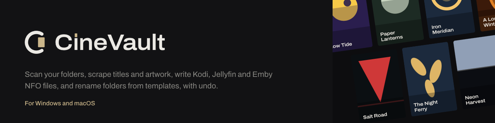

# CineVault

**A fast, free and open-source desktop library manager for your movies and TV shows, for Windows and Linux (beta).**

[](https://github.com/mustafayevt/CineVault/releases/latest)
[](https://github.com/mustafayevt/CineVault/actions/workflows/ci.yml)
[](LICENSE)

**[Download CineVault](https://mustafayevt.github.io/CineVault/)** · [All releases](https://github.com/mustafayevt/CineVault/releases) · [Changelog](CHANGELOG.md)

</div>

<p align="center">
  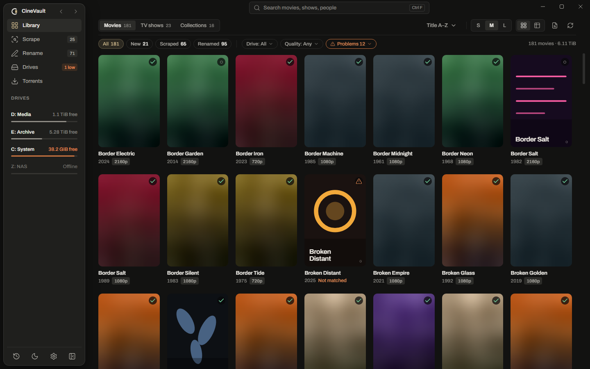
</p>

## What it does

- **Scan → Scrape → Rename.** Every title moves through three stages: New, Scraped, Renamed. Scan finds the movies and shows in your folders, Scrape matches each one online, Rename tidies folders and files from a template.
- **NFO and artwork for Kodi, Jellyfin and Emby.** Each Scrape writes complete NFO files and every artwork type (poster, fanart, logo, clear art, banner, disc art, thumb) in the formats your media centre reads.
- **TV shows.** Show, season and episode pages with missing and unaired episodes, specials and season artwork.
- **Ratings side by side.** TMDB, plus IMDb, Rotten Tomatoes, Metacritic, Letterboxd and Trakt with your own free OMDb or MDBList key.
- **Search as you type.** Type in the search box and matching titles appear at once, grouped, with your recent searches and See all results. Punctuation, spacing, accents and small typos do not matter; messy release names still match, with a confidence score for every candidate.
- **Library your way.** A poster grid with a size you choose, or a table with a Stage column whose columns you can move and resize.
- **HDR details.** The Technical card shows the exact HDR format (Dolby Vision profile, HDR10+, HDR10, HLG), audio and file details read from the file.
- **Drives with safe moves.** Free space per drive and Move to another drive: copy, verify, and only then do the originals go to the Recycle Bin (the Trash on Linux).
- **Deleted files handled your way.** Delete sends a title to the Recycle Bin or Trash, a trash folder on each drive or a trash folder you choose, and old trash can be emptied automatically. Shift+Delete erases a title only after you type a confirmation.
- **History and Undo.** Renames, moves, deletes, artwork and match changes are listed in History, each with Undo.
- **Collections.** A collection appears on its own once you own two or more films of the same set.
- **Torrent search hand-off.** Pick a title from the suggestions, search its releases from inside the app and see whether it is better than your copy; CineVault hands the one you pick to your own torrent app. You are responsible for what you download and share.
- **Desktop feel.** Light and dark themes that follow the system, zoom from 80% to 150%, keyboard chords for everyday actions, and a `cinevault` command line.
- **Naming styles.** One Style control in Settings › Naming (Clean, Detailed, Media-server safe) fills the movie folder, movie file and TV episode templates; edit any of them to make your own.
- **Private by design.** You bring your own provider keys, kept in the OS credential store (the system keyring on Linux). No account, no telemetry.

## Getting started

1. **Install.** Download the installer from the [website](https://mustafayevt.github.io/CineVault/) or the [releases page](https://github.com/mustafayevt/CineVault/releases). The Windows builds are not code-signed yet, so SmartScreen ("More info", then "Run anyway") warns on first launch.
   - **Linux (beta, 64-bit):** Ubuntu 22.04 or newer, Fedora 38 or newer. The AppImage needs FUSE 2 (`libfuse2t64` on Ubuntu 24.04): `chmod +x CineVault-x86_64.AppImage`, then open it; it updates itself from inside the app. Or install the `.deb` (`sudo apt install ./CineVault-amd64.deb`) or the `.rpm` (`sudo dnf install ./CineVault-x86_64.rpm`). If the window stays blank on some graphics drivers, start CineVault with `WEBKIT_DISABLE_DMABUF_RENDERER=1`.
   - **macOS:** a version is planned.
2. **Add your folders and a free TMDB key.** The first-run screen asks where your movies and shows are, then for a [TMDB API key](https://www.themoviedb.org/settings/api) (free; the only key needed to Scrape).
3. **Scan, Scrape, Rename.** Scanning starts on its own. Scrape your titles, check the Rename preview, apply. Everything can be undone from History.

## Use it in a browser (beta)

CineVault can run on the computer that holds your movies (a PC, a mini-PC or a NAS) and be used from
a browser on any phone, tablet or computer at home. Pick the way that fits; each is one command, and
running it again updates CineVault, changes its folders or removes it.

**Linux** (Ubuntu 22.04, Debian 12, Fedora 36 or newer; 64-bit): installs the `cinevault-server`
package and starts it as a service.

```sh
curl -fsSL https://mustafayevt.github.io/CineVault/install.sh | sh
```

**Windows** (with [Docker Desktop](https://docs.docker.com/desktop/setup/install/windows-install/)
installed and running): paste in PowerShell.

```powershell
irm https://mustafayevt.github.io/CineVault/install.ps1 | iex
```

**macOS** (with [Docker Desktop](https://docs.docker.com/desktop/setup/install/mac-install/)
installed and running): paste in Terminal.

```sh
curl -fsSL https://mustafayevt.github.io/CineVault/install.sh | sh
```

**NAS and Docker:** an [Unraid template](packaging/unraid/cinevault.xml), a
[Compose file](docker-compose.yml) for Synology, TrueNAS and others, and the image
`ghcr.io/mustafayevt/cinevault` ([how to](packaging/README.md#install-by-hand-with-docker)).

The installer asks for your movie and TV folders, starts CineVault and opens
`http://localhost:8787`; it also prints the address to use from other devices. Then:

1. **Choose a password** on the welcome page. It is open for 30 minutes after CineVault starts; if you
   miss it, restart CineVault and open the page again.
2. **Add your folders** in setup. On Linux they keep their usual paths. With Docker they appear under
   `/media/`, for example your `D:\Movies` is `/media/Movies`; the installer prints the list.
3. **Enter your free [TMDB key](https://www.themoviedb.org/settings/api)** and Scan.

<picture>
  <source srcset="site/img/server-login-light.webp" media="(prefers-color-scheme: light)">
  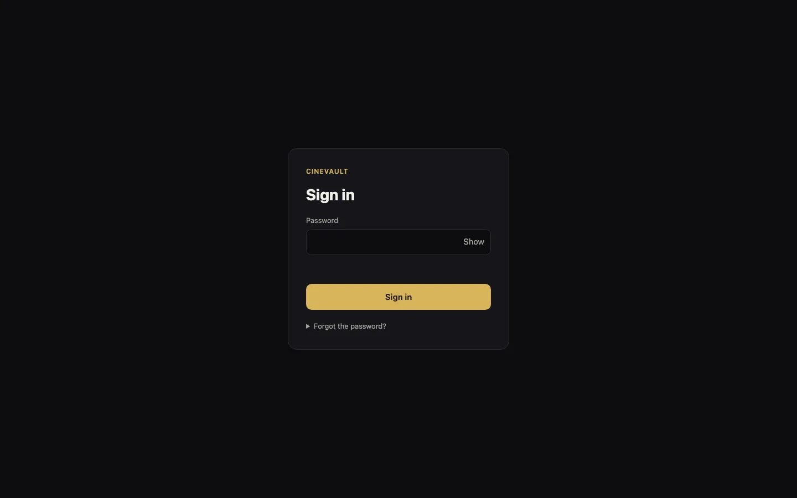
</picture>

Keep it on your home network or behind a VPN; never forward its port to the internet. Not in the
beta yet: ARM computers (Raspberry Pi, ARM NAS) and "Open in Kodi".
**[The full guide](packaging/README.md)** covers each step, the commands to stop, start and update it,
a forgotten password, backups, installing by hand with Docker or the packages, and troubleshooting.

The desktop app and the server can share a data folder, but only one may open it at a time. The
server holds a `library-owner.json` lock; the desktop app refuses that folder and the `cinevault`
command line exits with code 2 instead of writing behind the server's back.

## Screenshots

<table>
  <tr>
    <td width="50%" valign="top">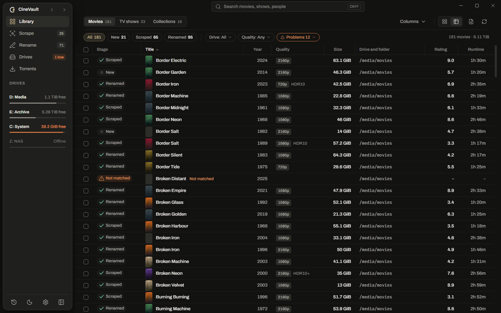<br><sub>Library table: a Stage column, movable and resizable columns</sub></td>
    <td width="50%" valign="top">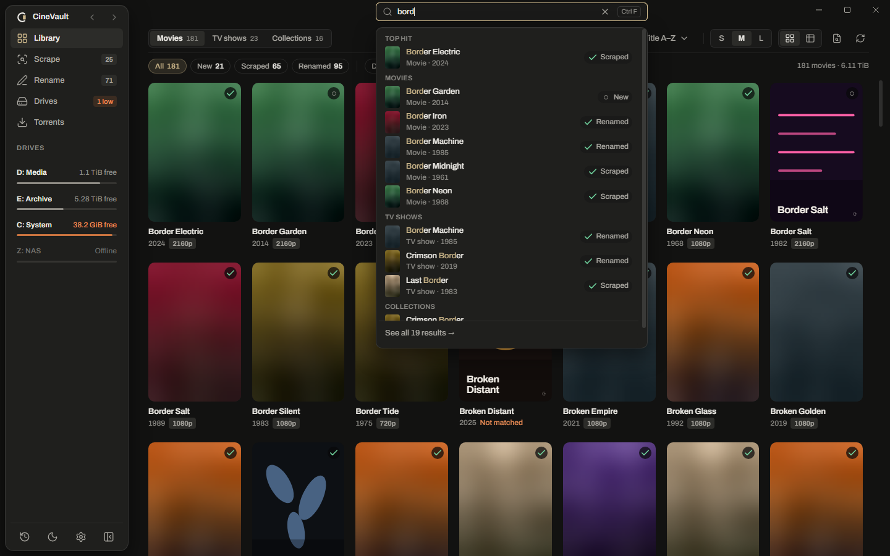<br><sub>Search as you type, with your recent searches</sub></td>
  </tr>
  <tr>
    <td width="50%" valign="top">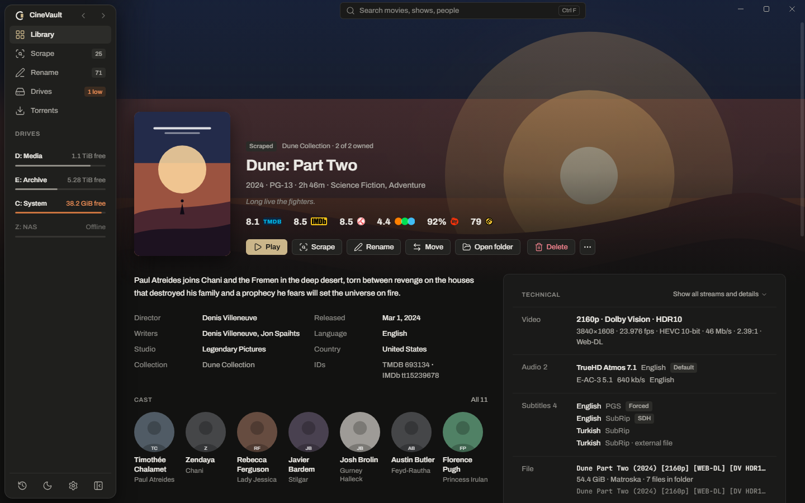<br><sub>Movie page: ratings, cast and the Technical card</sub></td>
    <td width="50%" valign="top">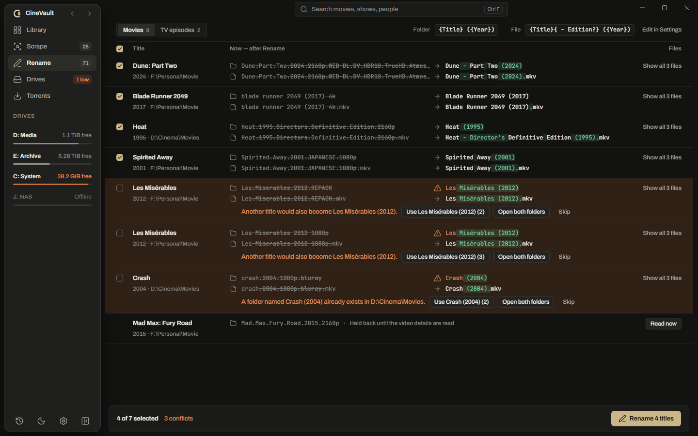<br><sub>Rename: a word-level preview, conflicts resolved on the row</sub></td>
  </tr>
  <tr>
    <td width="50%" valign="top">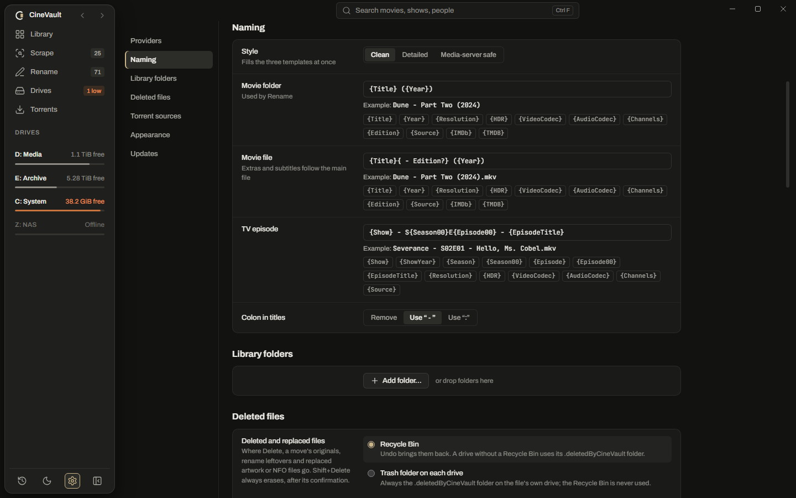<br><sub>Naming styles: one choice fills all three templates</sub></td>
    <td width="50%" valign="top">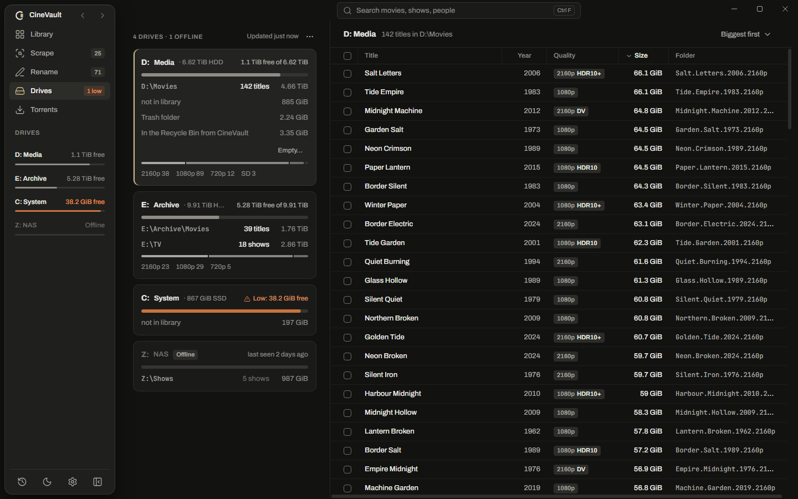<br><sub>Drives: free space and safe moves between drives</sub></td>
  </tr>
  <tr>
    <td width="50%" valign="top">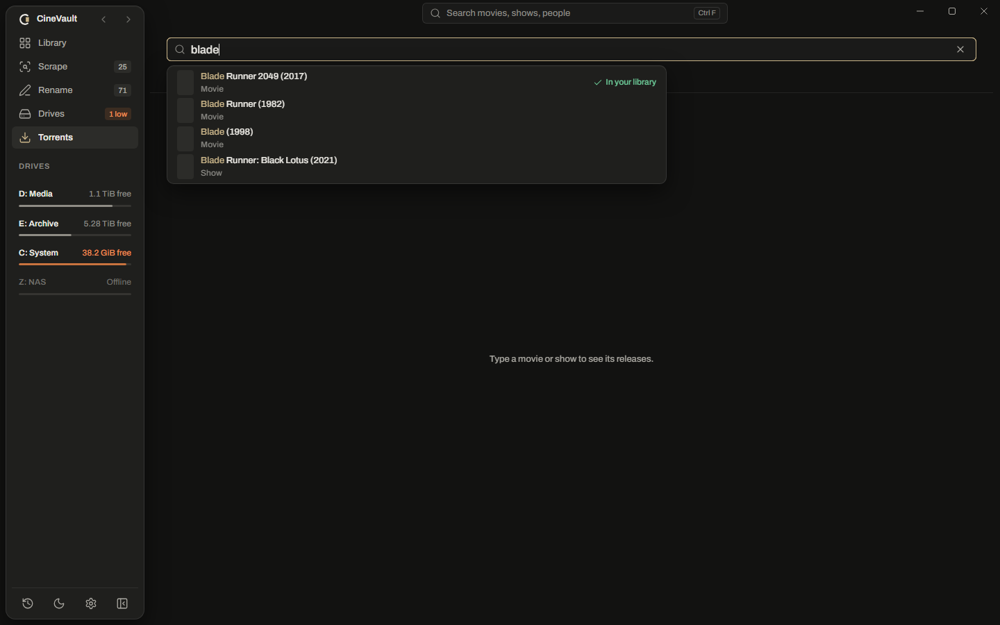<br><sub>Torrents: pick the title from the suggestions</sub></td>
    <td width="50%" valign="top">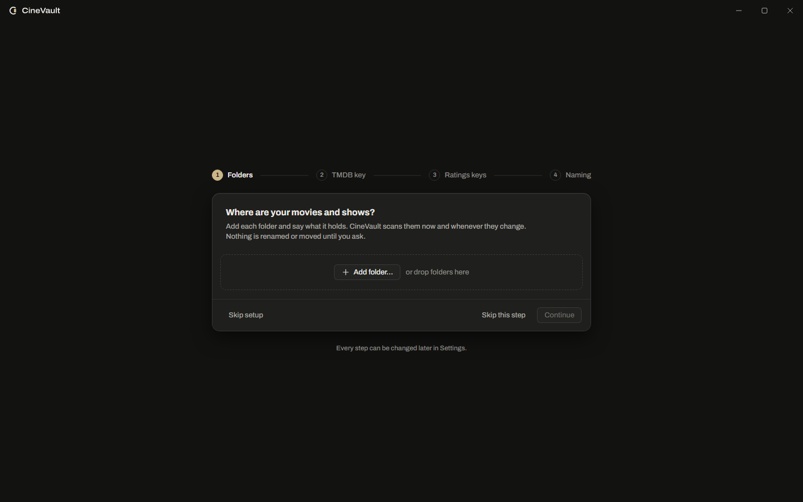<br><sub>First run: add your folders, then your own provider keys</sub></td>
  </tr>
</table>

<p align="center"><sub>Screenshots are taken against the app's built-in sample library.</sub></p>

## Build from source

You need the [Rust](https://rustup.rs) stable toolchain (MSVC on Windows), [bun](https://bun.sh) and the [Tauri 2 prerequisites](https://v2.tauri.app/start/prerequisites/) (WebView2 on Windows; on Linux the WebKitGTK and `libdbus` development packages).

```sh
bun install && (cd ui && bun install)
bun run tools:fetch      # pinned MediaInfo, FFmpeg and helper tools into .dev-tools/
bun run tauri dev        # run the desktop app
bun run tauri build      # installers under target/release/bundle/
```

The checks to run before a pull request are listed in [CONTRIBUTING.md](CONTRIBUTING.md).

## Contributing

CineVault is open source, and contributions are welcome: bug reports, ideas, documentation and pull requests. Read [CONTRIBUTING.md](CONTRIBUTING.md) first; contributors and AI coding assistants also follow [AGENTS.md](AGENTS.md). Every change, including the maintainer's, lands through a pull request from a branch, and CI must pass before it is merged. Please report security issues privately, as described in [SECURITY.md](SECURITY.md).

## Licence

CineVault is licensed under the [Apache License 2.0](LICENSE). See [NOTICE](NOTICE) and [THIRD_PARTY_NOTICES.md](THIRD_PARTY_NOTICES.md).

<sub>This product uses the TMDB API but is not endorsed or certified by TMDB.</sub>
